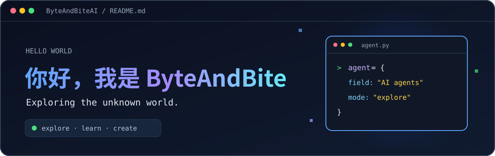
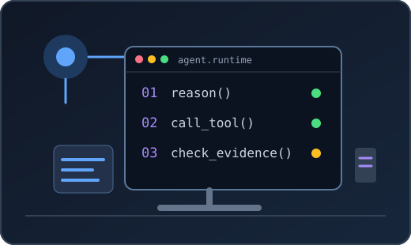

👋 你好，欢迎来到我的 GitHub 小角落。

## ABOUT ME · 关于我

<table>
  <tr>
    <td width="58%" valign="top">
      <h3>✨ 一点自我介绍</h3>
      
我是 <strong>ByteAndBite</strong>，中国科学技术大学硕士在读，预计 2029 年毕业。

      
我正在学习并构建 LLM Agent 系统，喜欢先把核心循环和工具调用弄明白，再逐步做好上下文管理、检索与评估。

      
目前关注 Agent 在真实任务中的可靠性：<strong>状态可恢复、工具边界清晰、回答有据可查</strong>。

      
🎯 希望寻找 <strong>AI Agent 工程方向</strong>的实习机会。

    </td>
    <td width="42%" align="center" valign="middle">
      
    </td>
  </tr>
</table>

## BUILD LOG · 正在探索

| 方向 | 我在关注什么 |
| :--- | :--- |
| **Agent Runtime** | 工具调用链、上下文管理、检查点与恢复 |
| **RAG & Evaluation** | 检索质量、证据对齐、可复现的评估 |
| **Tooling & MCP** | 清晰的工具协议与安全边界 |

## TOOLBOX · 工具箱

`Python` · `Git` · `Bash` · `LLM APIs` · `MCP`

## CONTRIBUTIONS · 提交轨迹

  <picture>
    <source media="(prefers-color-scheme: dark)" srcset="https://raw.githubusercontent.com/ByteAndBiteAI/ByteAndBiteAI/output/github-contribution-grid-snake-dark.svg" />
    
  </picture>

  持续构建，认真记录。 · Build, measure, improve.

